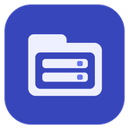
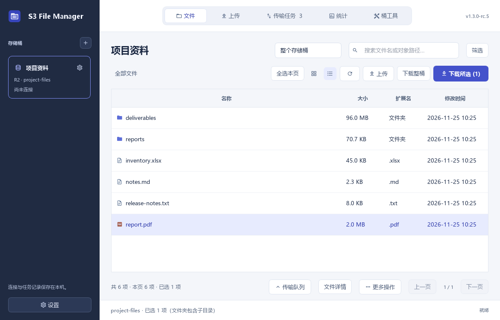

<h1 align="center">S3 File Manager</h1>

Browse Cloudflare R2, Backblaze B2 and compatible S3 storage, transfer files in batches and run incremental archives.

<a href="README.md">简体中文</a> · <strong>English</strong>

  
  
  
  

  <a href="#downloads"><strong>Downloads</strong></a> · <a href="#quick-start">Quick start</a> · <a href="#features">Features</a> · <a href="CHANGELOG.md">Changelog</a>

## Downloads

| Platform | Installation |
| --- | --- |
| Windows 10 / 11 x64 | Download `*-windows-x64-setup.exe` from [Releases](https://github.com/Jerryzjy/S3-File-Manager/releases). Run the installer, then open the app from the Start menu. A portable ZIP and in-app update check are also available. |
| macOS, Apple Silicon and Intel | Check [Releases](https://github.com/Jerryzjy/S3-File-Manager/releases) for the preview. Choose `*-macos-arm64.dmg` for Apple Silicon or `*-macos-x86_64.dmg` for Intel. Open the image and drag the app to Applications. [Build status](https://github.com/Jerryzjy/S3-File-Manager/actions/workflows/build-macos.yml) |

To update the macOS preview, open the new DMG and replace the app manually. The app is ad hoc signed and awaits Apple Developer ID signing and notarization.

## Quick start

[Open the illustrated user guide](docs/guide.en.md)

1. Add a bucket from the sidebar and select a storage provider.
2. Enter the connection information, test the connection and save it. Read access is sufficient for browsing, downloads and archives.
3. Select files or a folder and click **Download selected** (下载所选). Review the save location, disk space and conflict policy. Open the transfer queue to follow progress.

| Service | Connection details |
| --- | --- |
| Cloudflare R2 | Account ID, bucket, Access Key ID and Secret Access Key. You can also set a custom HTTPS endpoint. |
| Backblaze B2 | Bucket, S3 endpoint, keyID and applicationKey. The app reads the region from the endpoint. |
| Custom S3 | Bucket, HTTPS endpoint, region, Access Key ID and Secret Access Key. |

## Features

### Connections and browsing

- **Multiple buckets**. Save and switch between connections in the sidebar. Protect saved secrets with Windows DPAPI or the macOS Keychain.
- **File browsing**. Switch between grid and list view. Browse directory pages while the background index loads.
- **Object search**. Search the whole bucket or the current directory and its subdirectories. Filter by extension, size and modified date. Sort by column, inspect details and copy the object key.

### Downloads, uploads and transfer recovery

- **Batch downloads**. Select files, folders, the current directory or the whole bucket. Check size, disk space and local conflicts before starting. Preserve the object directory structure on disk.
- **R2 uploads**. Open the **Upload** (上传) tab to pick or drop local files and folders, then preview the destination keys. Skip, rename or confirm overwrites for conflicting names. Files of 64 MiB and above use multipart uploads.
- **Upload sources**. Paste local files or text, or download files from HTTPS URLs into a local folder before uploading.
- **Resume**. Downloads validate object identity before resuming. R2 multipart uploads can continue an active session after a pause, disconnect or restart. Cancelling can clean up unfinished parts. Small uploads restart the file when resumed.
- **Transfer control**. Open the queue while browsing. View progress, speed and failures, pause or resume a batch, retry failed items, open the destination folder and export a CSV of failures. Clearing task history keeps completed files.

### Incremental archives, copies and sharing

- **Incremental archives**. Choose **More actions** (更多操作) and preview new, changed or locally missing items using the last successful archive. Use the same source scope and local folder for subsequent archives. Other local files stay in place.
- **R2 bucket copies**. Copy files to a folder in the same bucket or copy a single object to a new name. Copies use the native R2 endpoint and preserve the source and existing destinations. The per-object copy limit is approximately 4.995 GiB.
- **Expiring R2 links**. Generate a download link for a single object for 15 minutes, 1 hour, 24 hours or 7 days. View its expiry and copy the link.
- **Statistics and bucket tools**. Inspect object counts, stored bytes, local transfer activity and sync history. Bucket tools provide full-bucket downloads, incremental archives and content-based duplicate scans.

### Settings and troubleshooting

- **Download settings**. Set the default destination, transfer concurrency and local conflict policy. Profiles, tasks and checkpoints stay in the current user's data directory.
- **Software updates**. Use **Settings → Software update → Check for updates** (设置 → 软件更新 → 检查更新). Windows can download and install updates in the app. macOS can open the download for the current chip.
- **Connection checks**. Check the bucket, endpoint, region and permissions if the connection fails. R2 uploads and copies need read and write access.
- **Feedback**. Include the app version, operating system, steps and any error shown when you report a problem. [Report an issue](https://github.com/Jerryzjy/S3-File-Manager/issues)

## Open source

Licensed under [GPL-3.0](LICENSE). See [Contributing](CONTRIBUTING.md) for running tests and building the app. [Security policy](SECURITY.md) · [Third-party notices](THIRD_PARTY_NOTICES.md)
