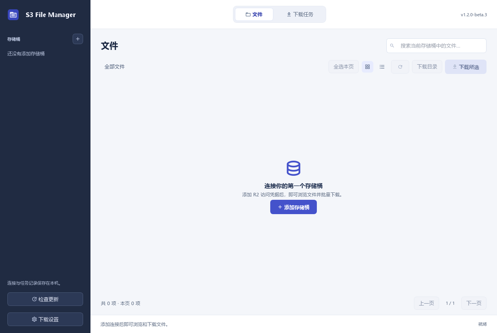

# S3 File Manager

面向 Windows 的对象存储桌面客户端。当前支持 **Cloudflare R2**，可以浏览存储桶、批量下载文件，并在暂停或重启后手动续传。

**[下载 Windows 版](https://github.com/Jerryzjy/S3-File-Manager/releases)** · [更新记录](CHANGELOG.md) · [贡献指南](CONTRIBUTING.md) · [报告安全问题](SECURITY.md)



## 适用范围

- **系统** · Windows 10 / 11，64 位
- **支持的平台** · Cloudflare R2
- **当前版本** · `1.2.0-beta.3`，预发布版
- **规划** · 上传、文件管理及其他 S3 兼容服务适配。 [开发路线图](PRODUCT_ROADMAP.md)

## 开始使用

1. 从 Releases 下载文件名以 `windows-x64.zip` 结尾的压缩包，解压后双击 `S3FileManager.exe`。 [查看发布版本](https://github.com/Jerryzjy/S3-File-Manager/releases)
2. 点击「添加存储桶」，填写连接名称、Cloudflare Account ID、Bucket 名称、Access Key ID 和 Secret Access Key。浏览和下载使用该存储桶的对象只读权限即可。需要指定 S3 Endpoint 时，通过高级选项填写 HTTPS 地址。
3. 点击「测试连接」，验证通过后点击「连接并保存」。
4. 双击进入目录，选中文件或文件夹后点击「下载所选」。要下载当前目录及其子目录中的所有文件，使用「下载目录」。
5. 选择保存位置。确认框会显示对象数量、总大小、可用空间和本地文件冲突。确认后点击「开始下载」，在「下载任务」中查看进度。

第一次使用时会显示空白工作区，添加自己的存储桶后才会出现文件。当前目录优先加载，后台继续建立全桶索引。索引完成后，可以搜索整个存储桶、跨页选择文件和递归下载目录。

## 下载与续传

- 保留对象目录层级，支持调整并发数、暂停、继续、取消和重试失败项。
- 暂停后，下载目录中的 `.r2-*` 临时文件用于续传。保留这些文件并在客户端手动继续。续传时会核对远端文件大小和 ETag。
- 默认跳过本地同名同大小文件。若需确认本地内容是否相同，请另行比较文件内容。
- 移除连接或清理任务记录只影响本机记录。已下载文件和云端对象会保留。

## 密钥和本机数据

Secret Access Key 默认仅用于当前会话。可选的「记住密钥」使用 Windows DPAPI 加密，供当前登录用户在本机再次打开时使用。

连接、下载设置和任务记录位于 `%APPDATA%\R2BatchDownloader\client-state.json`。同一 Windows 用户可继续使用旧版 R2 下载器的配置和可用断点。诊断日志位于同目录下的 `logs`。

## 软件更新

打开侧栏的「检查更新」。发现新版后可以查看版本和变更说明。先让当前下载结束或暂停，再点击「下载并安装」。客户端会核对更新文件的大小与 SHA-256，保存任务记录，然后重启。

`1.2.0-beta.3` 起内置 GitHub 更新地址。`1.2.0-beta.2` 可在「检查更新」中手动填写以下地址。使用更早版本时，先从 Releases 下载新版 ZIP，解压后双击启动。

```text
https://raw.githubusercontent.com/Jerryzjy/S3-File-Manager/main/updates/windows-x64.json
```

## 从源码运行

在 Windows 上安装 Python 3.10 或更新版本，然后在仓库根目录运行以下 PowerShell 命令。

```powershell
python -m venv .venv
.\.venv\Scripts\python.exe -m pip install -r requirements.txt
.\.venv\Scripts\python.exe client_launcher.py
```

维护者可使用 PyInstaller 构建便携版。 [测试与构建说明](CONTRIBUTING.md)

## 验证状态与许可

现有测试覆盖离线 S3 列举、批量下载、断点恢复、凭据加密、更新文件校验及 Windows EXE 替换。真实 Cloudflare R2 大批量下载和 GitHub 在线更新仍待端到端验收。

本项目按 GPL-3.0 发布。第三方组件按各自许可分发。 [许可证](LICENSE) · [第三方组件](THIRD_PARTY_NOTICES.md)

## English

S3 File Manager is a Windows desktop app for browsing Cloudflare R2 buckets, batch-downloading objects, and resuming interrupted transfers. The current release is a Windows x64 beta. More S3-compatible providers are planned. [Download](https://github.com/Jerryzjy/S3-File-Manager/releases) · [Contributing](CONTRIBUTING.md)
