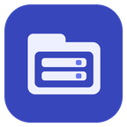

<h1 align="center">S3 File Manager</h1>

连接 Cloudflare R2、Backblaze B2 和 S3 兼容存储，浏览文件、批量传输和增量归档。

<strong>简体中文</strong> · <a href="README.en.md">English</a>

  
  
  
  

  <a href="#下载与安装"><strong>下载与安装</strong></a> · <a href="#快速上手">快速上手</a> · <a href="#功能与支持范围">功能</a> · <a href="CHANGELOG.md">更新记录</a>

## 下载与安装

| 平台 | 安装方式 |
| --- | --- |
| Windows 10 / 11（x64） | 从 [Releases](https://github.com/Jerryzjy/S3-File-Manager/releases) 下载 `*-windows-x64-setup.exe`，运行后从开始菜单打开。也有便携 ZIP。 |
| macOS（Apple 芯片、Intel） | 在 [Releases](https://github.com/Jerryzjy/S3-File-Manager/releases) 查看 macOS 预览版。Apple 芯片选 `*-macos-arm64.dmg`，Intel 选 `*-macos-x86_64.dmg`。打开镜像，将应用拖入「应用程序」。[构建状态](https://github.com/Jerryzjy/S3-File-Manager/actions/workflows/build-macos.yml) |

macOS 预览版需打开新版 DMG 并手动替换应用。镜像使用临时签名，尚无 Apple Developer ID 签名及公证。

## 快速上手

1. 在左侧点击「添加存储桶」，选择服务并填写连接信息。
2. 点击「测试连接」，通过后选择「连接并保存」。浏览、下载和归档可使用目标桶的只读密钥。
3. 选中文件或文件夹，点击「下载所选」。确认保存目录、可用空间和同名文件处理方式后开始。点击底部「传输队列」可随时查看进度。

| 服务 | 要填写的信息 |
| --- | --- |
| Cloudflare R2 | Account ID、Bucket、Access Key ID、Secret Access Key。可选填自定义 HTTPS Endpoint。 |
| Backblaze B2 | Bucket、桶页面的 S3 Endpoint、keyID、applicationKey。客户端从 Endpoint 读取 Region。 |
| 自定义 S3 | Bucket、HTTPS Endpoint、Region、Access Key ID、Secret Access Key。 |

## 功能与支持范围

### 连接与文件浏览

- **多桶连接**：保存多个 R2、B2 或自定义 S3 连接，在侧栏切换。可选择通过 Windows DPAPI 或 macOS 钥匙串保护保存的密钥。
- **目录浏览**：支持网格、列表和分页。后台索引时，可先浏览已经返回的目录页。
- **查找对象**：按名称或对象路径搜索，范围可选整桶或当前目录及子目录。筛选支持扩展名、大小和修改日期。可按列排序、查看详情及复制对象 Key。

### 下载、上传与传输恢复

- **批量下载**：选择多个文件、文件夹、当前目录或整桶。预检显示数量、总大小、磁盘空间和本地同名冲突，可保留对象目录结构。
- **R2 上传**：在顶部「上传」页选择或拖入本地文件和文件夹，预览目标对象 Key。同名可跳过、自动改名或确认覆盖。64 MiB 及以上自动使用分片上传。
- **上传来源**：可粘贴本地文件和文本，或将 HTTPS 网址中的文件保存到本地后上传。
- **断点恢复**：下载会核对对象身份再续传。R2 大文件上传可在断网、暂停或重启后继续有效会话，未完成分片可在取消时清理。继续小文件上传时会从头传该文件。
- **任务管理**：文件页可展开队列，传输任务页显示进度、速度和失败原因。可按批次暂停、继续、重试失败项、打开保存目录、导出失败 CSV 或清理任务记录。已完成的文件会保留。

### 增量归档、复制与分享

- **增量归档**：点击「更多操作 → 增量归档」。重复选择同一范围和本地目录，可按上次成功记录预览新增、变更和本地缺失文件，下载时保留本地其他资料。
- **R2 桶内复制**：选择文件后，可复制到桶内目录，也可将单文件复制为新名称。使用 R2 原生 S3 Endpoint，单文件上限约 4.995 GiB。操作保留源对象和已存在的同名目标。
- **R2 限时链接**：在「更多操作」为单个文件生成 15 分钟、1 小时、24 小时或 7 天的下载链接。可复制链接并查看到期时间。
- **统计与桶工具**：查看对象数、大小、本机活动和同步记录。R2 操作次数需要具有 `Analytics Read` 权限的账户 API Token。桶工具提供整桶下载、增量归档及基于对象内容的重复扫描。

### 设置与排障

- **下载设置**：选择默认保存目录、并发数和本地同名处理方式。配置、任务和断点保存在当前用户目录中。
- **软件更新**：打开左下角「设置 → 软件更新」，点击「检查更新」。Windows 可直接下载并安装。macOS 可下载适配当前芯片的 DMG。
- **连接诊断**：连接失败时，核对桶名、服务商 Endpoint、Region 和密钥权限。R2 上传和复制需要对象读取及写入权限。
- **问题报告**：通过「设置 → 诊断」导出 ZIP。提交问题时请附系统、版本、复现步骤及诊断文件。[反馈问题](https://github.com/Jerryzjy/S3-File-Manager/issues)

## 开源

项目采用 [GPL-3.0](LICENSE)。源码运行、测试和构建见 [贡献指南](CONTRIBUTING.md)。[安全政策](SECURITY.md) · [第三方许可](THIRD_PARTY_NOTICES.md)
