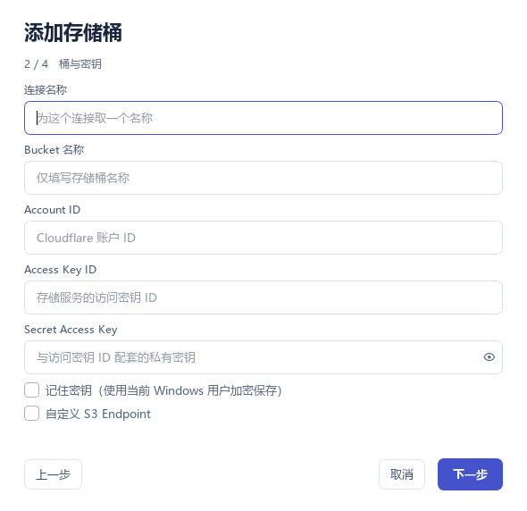
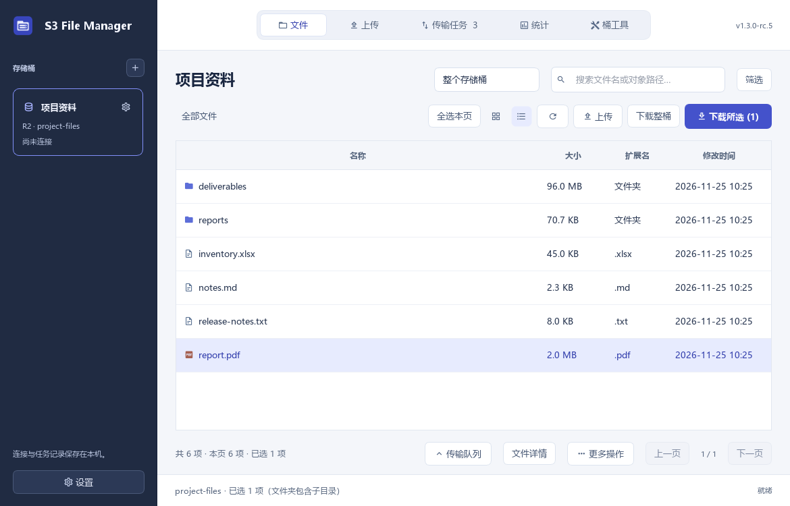
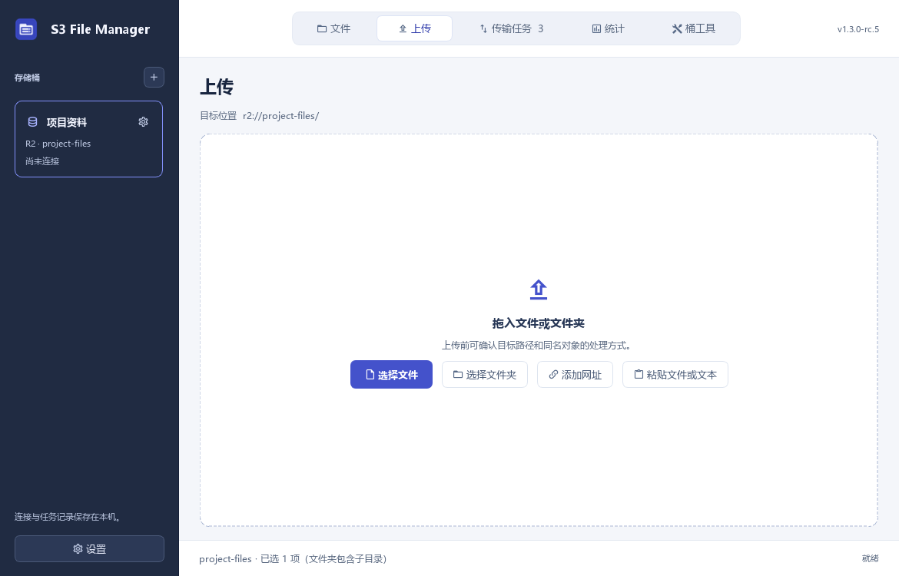
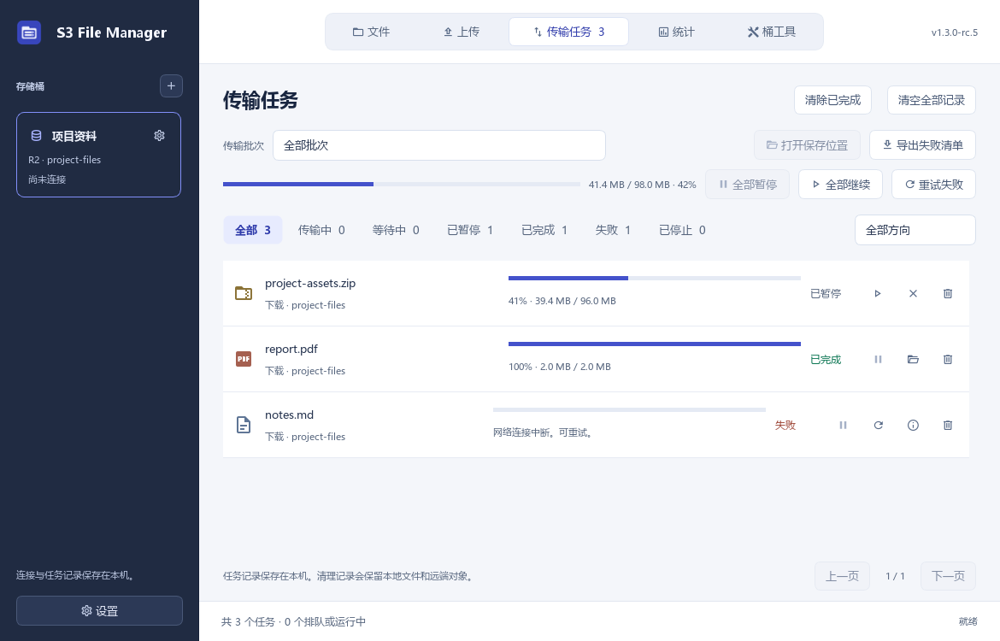
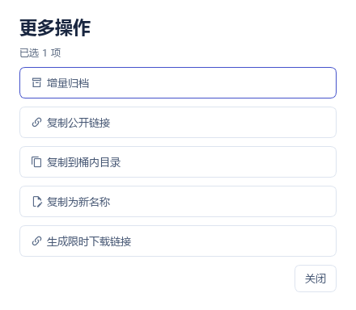
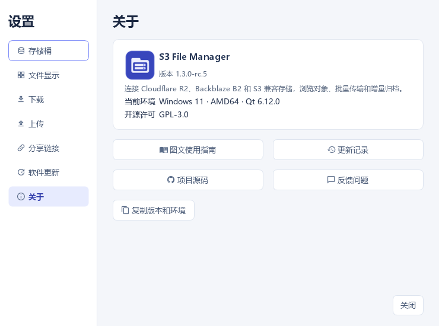

# S3 File Manager user guide

[简体中文](guide.zh-CN.md)

1. [Install the app](#1-install-the-app)
2. [Connect a bucket](#2-connect-a-bucket)
3. [Browse and download](#3-browse-and-download)
4. [Upload to Cloudflare R2](#4-upload-to-cloudflare-r2)
5. [Pause, resume and retry](#5-pause-resume-and-retry)
6. [Archive, share and inspect a bucket](#6-archive-share-and-inspect-a-bucket)
7. [Update and report an issue](#7-update-and-report-an-issue)

Screenshots show the v1.3.0-rc.5 test build with sample files in the Chinese desktop interface. The installed app opens to an empty workspace until you connect a bucket.

## 1. Install the app

1. Open [GitHub Releases](https://github.com/Jerryzjy/S3-File-Manager/releases).
2. On Windows 10 or 11 x64, download `*-windows-x64-setup.exe`. Run the installer, choose a location and optional desktop shortcut, then launch **S3 File Manager** from the Start menu.
3. On Mac, download `*-macos-arm64.dmg` for Apple silicon or `*-macos-x86_64.dmg` for Intel. Open the image and drag the app to Applications. The Mac preview is ad hoc signed.

## 2. Connect a bucket

1. Click **＋** next to the bucket list and choose a provider.
2. Give the connection a name and enter the S3 details. Use bucket-scoped read-only credentials for browsing, downloads and archiving.

   | Provider | Required connection details |
   | --- | --- |
   | Cloudflare R2 | Account ID or R2 S3 endpoint, bucket, Access Key ID and Secret Access Key |
   | Backblaze B2 | Bucket, S3 endpoint, keyID and applicationKey |
   | Custom S3 | Bucket, HTTPS endpoint, region, Access Key ID and Secret Access Key |

   

3. Optionally enter an HTTPS domain already enabled by your provider for public object links.
4. Review the configuration and click **Connect and save** (连接并保存). The file list starts loading after the bucket read check succeeds.

## 3. Browse and download

1. Select a bucket. Double-click folders to open them. Search by name or key, or filter by extension, size and date.
2. Select items and click **Download selected** (下载所选). To download the whole scope, use **Download bucket** (下载整桶) at the root or **Download folder** (下载目录) inside a folder.
3. Choose your local destination and conflict behavior. Review disk space and file conflicts before starting.

## 4. Upload to Cloudflare R2

1. Select an R2 bucket. Open the destination folder in the file browser, then select **Upload** (上传).
2. Confirm the destination and drop or choose files and folders. You can also paste files or text, or import files from HTTPS URLs to a local folder first.
3. Review the target keys and choose how to handle existing objects before starting the upload.

## 5. Pause, resume and retry

1. Open **Transfers** (传输任务) and filter by state, batch or direction.
2. Pause or resume a single task or the current group of tasks.
3. Open the details of failed tasks to see what happened and retry when ready. Downloads check object identity before resuming. Small R2 uploads restart the file. Multipart uploads can reuse a valid session.

## 6. Archive, share and inspect a bucket

1. Open **More actions** (更多操作) in the file browser. v1.3.0-rc.4 uses a dropdown, and v1.3.0-rc.5 opens a dialog. Select a single file to generate an expiring R2 download link or copy a link for a configured public domain. R2 bucket copies require the native R2 S3 endpoint.
2. Use **Incremental archive** (增量归档) for a local copy. Reuse the same scope and destination to preview new, changed and locally missing files on later runs.
3. **Bucket tools** (桶工具) offers whole-bucket downloads and content-based duplicate scans with retention suggestions and export.

## 7. Update and report an issue

1. Open **Settings → Software update** (设置 → 软件更新), then **Check for updates** (检查更新). Windows can install the update from the app. On Mac, download the matching DMG and replace the app in Applications.
2. Include the app version, operating system, steps and any error shown when reporting an issue. In v1.3.0-rc.5, you can copy the version and system details from **Settings → About** (设置 → 关于). [Report an issue](https://github.com/Jerryzjy/S3-File-Manager/issues)

