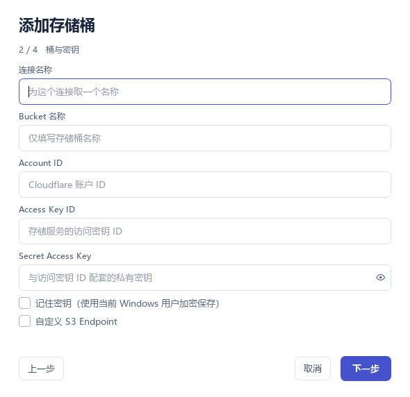
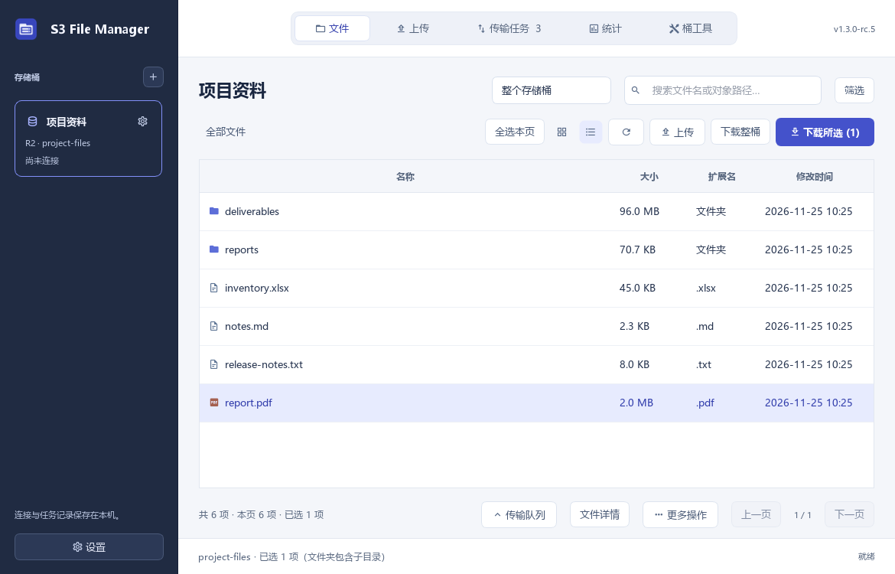
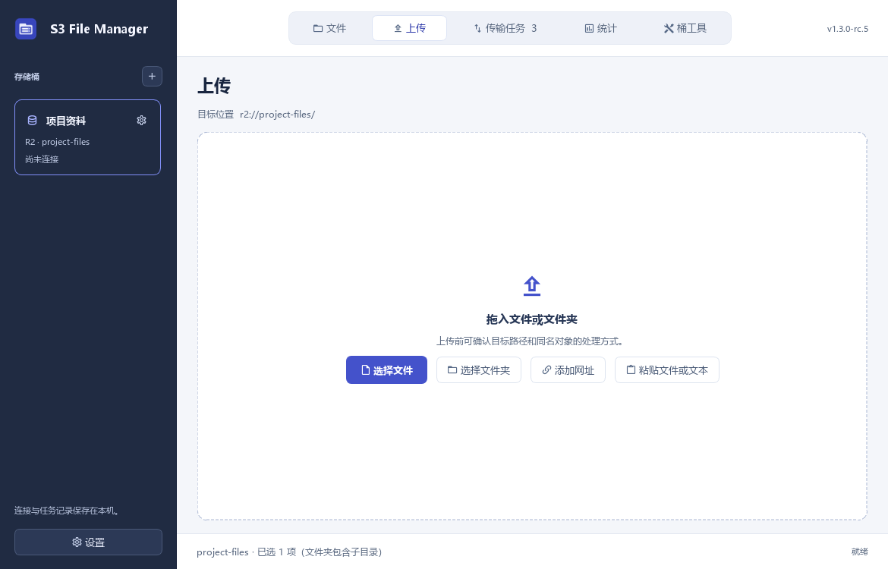
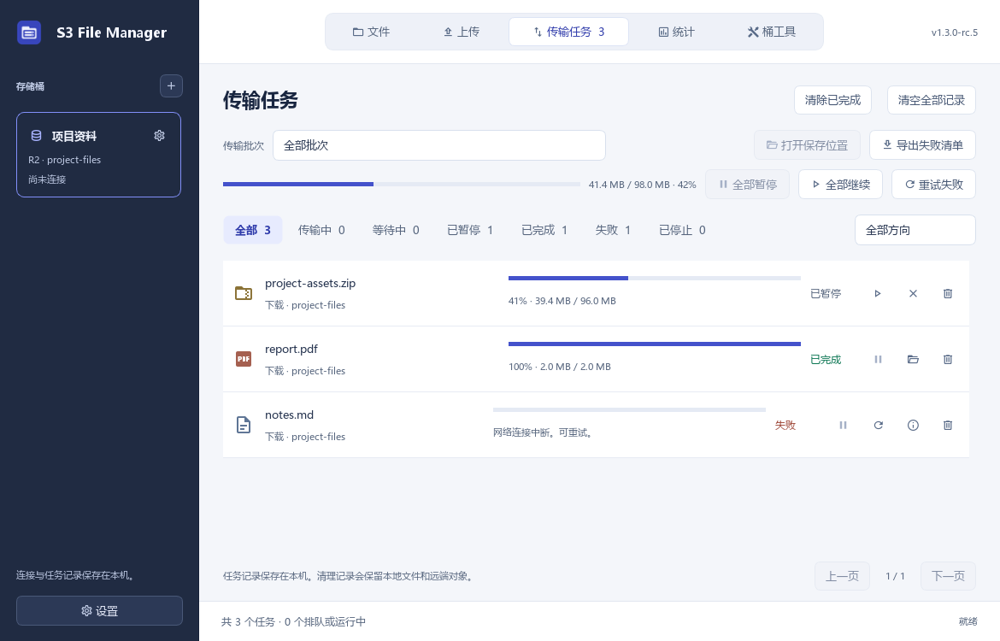
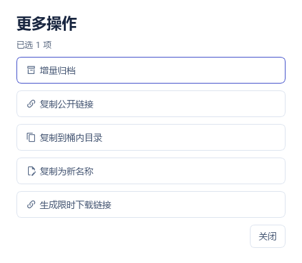
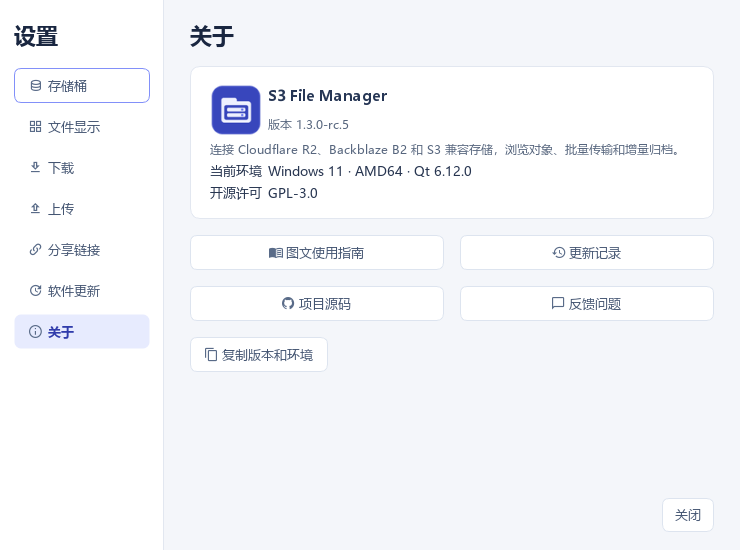

# S3 File Manager 使用指南

[English](guide.en.md)

1. [安装客户端](#1-安装客户端)
2. [连接存储桶](#2-连接存储桶)
3. [浏览和批量下载](#3-浏览和批量下载)
4. [上传到 Cloudflare R2](#4-上传到-cloudflare-r2)
5. [暂停、继续和重试](#5-暂停继续和重试)
6. [归档、分享和桶工具](#6-归档分享和桶工具)
7. [更新客户端与反馈问题](#7-更新客户端与反馈问题)

截图来自 v1.3.0-rc.5 测试版，使用示例桶和示例文件。首次打开客户端时，从「添加存储桶」开始。

## 1. 安装客户端

1. 打开 [GitHub Releases](https://github.com/Jerryzjy/S3-File-Manager/releases)。
2. Windows 10 / 11 x64 下载 `*-windows-x64-setup.exe`，运行安装向导，可选安装目录和桌面快捷方式。安装后从开始菜单打开 **S3 File Manager**。
3. Mac 根据芯片选择 `*-macos-arm64.dmg` 或 `*-macos-x86_64.dmg`。打开镜像，把应用拖到「应用程序」后启动。macOS 预览版使用临时签名。

## 2. 连接存储桶

1. 点击左侧「存储桶」旁的 **＋**，选择服务商。
2. 在「桶与密钥」填写连接名称和访问凭据。只浏览、下载或归档时，可使用目标桶的只读凭据。

   | 服务商 | 必填字段 |
   | --- | --- |
   | Cloudflare R2 | Account ID 或 R2 S3 Endpoint、Bucket、Access Key ID、Secret Access Key |
   | Backblaze B2 | Bucket、S3 Endpoint、keyID、applicationKey |
   | 自定义 S3 | Bucket、HTTPS Endpoint、Region、Access Key ID、Secret Access Key |

   

3. 如需复制对象的公开链接，填入服务商已开通的 HTTPS 域名。私有桶可留空。
4. 在最后一步检查信息，点击「连接并保存」。软件验证目标桶的读取权限后，开始读取文件列表。

## 3. 浏览和批量下载

1. 左侧选择桶。双击文件夹进入目录，用路径栏返回上一级。可按名称或对象路径搜索，也可按类型、大小和修改日期筛选。
2. 勾选文件或文件夹，点击「下载所选」。下载整个范围时，在桶根目录点击「下载整桶」，在子目录点击「下载目录」。
3. 选择本地保存位置和同名文件处理方式。检查预检结果，确认空间和目标路径后开始下载。

## 4. 上传到 Cloudflare R2

1. 左侧选择 R2 桶。要传到已有子目录，先在文件页进入该目录，再切换到顶部「上传」。
2. 确认顶部的目标位置，拖入或选择文件或文件夹。也可以粘贴文件或文本，或从 HTTPS 网址导入到本地后上传。
3. 检查对象路径预览，选择跳过、改名或确认覆盖同名对象，再点击「开始上传」。

## 5. 暂停、继续和重试

1. 打开「传输任务」，可按状态、批次和方向筛选。
2. 使用任务行的暂停或继续按钮，也可暂停或继续当前筛选范围的任务。
3. 失败项可打开详情查看原因，处理后点重试。下载会核对远端对象后续传。R2 小文件上传继续时会重新上传整个文件，分片上传可恢复仍有效的会话。

## 6. 归档、分享和桶工具

1. 在文件页点击「更多操作」。v1.3.0-rc.4 使用下拉菜单，v1.3.0-rc.5 改用操作面板。单选文件后可生成 R2 限时下载链接，已设置公开域名的桶可复制公开链接。R2 原生 S3 Endpoint 支持桶内复制和复制为新名称。
2. 要保留一份本地副本，点击「增量归档」。重复使用同一范围和本地目录时，可预览新增、变更和本地缺失的文件。
3. 顶部「桶工具」提供整桶下载和重复文件扫描。按内容校验后，可以标记建议保留的文件并导出结果。

## 7. 更新客户端与反馈问题

1. 点击左下角「设置 → 软件更新 → 检查更新」。Windows 可从应用内下载安装。Mac 可打开对应 DMG 的下载，再手动替换应用。
2. 如需反馈，记录应用版本、操作系统、操作步骤和错误提示。v1.3.0-rc.5 可在「设置 → 关于」复制版本和环境。[反馈问题](https://github.com/Jerryzjy/S3-File-Manager/issues)

